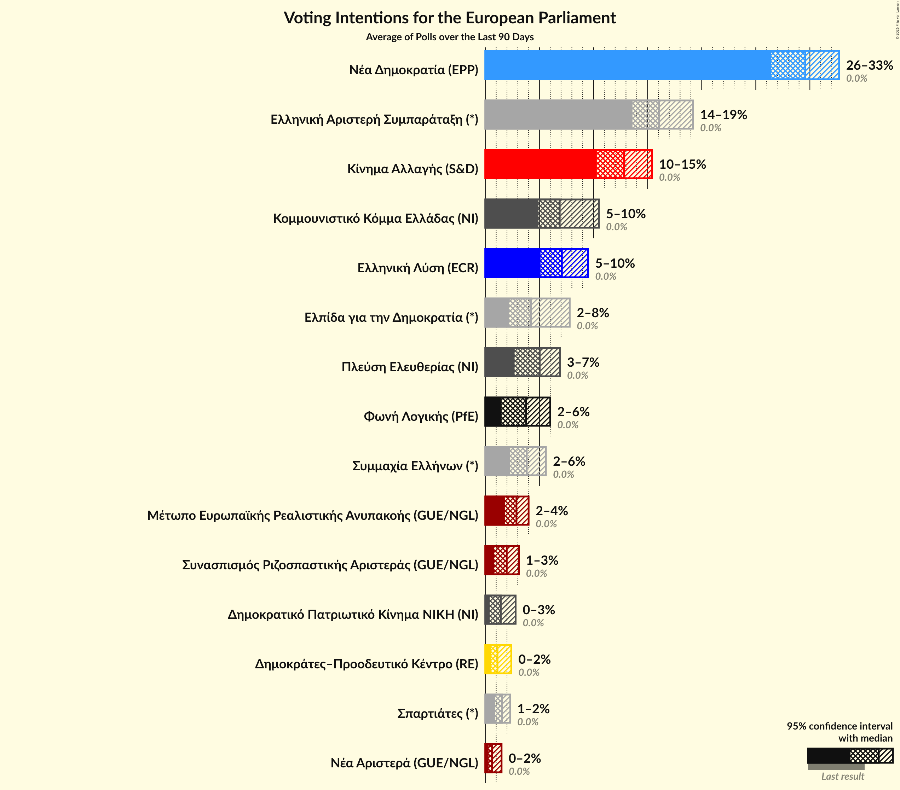
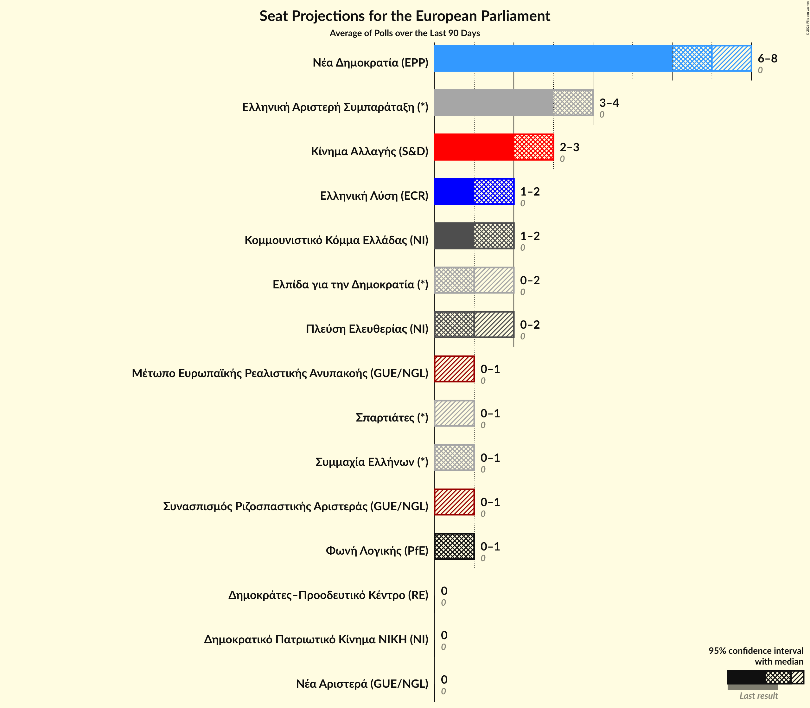
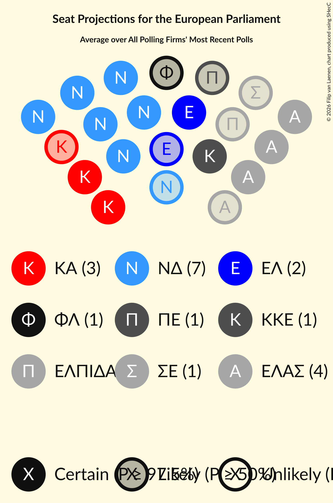
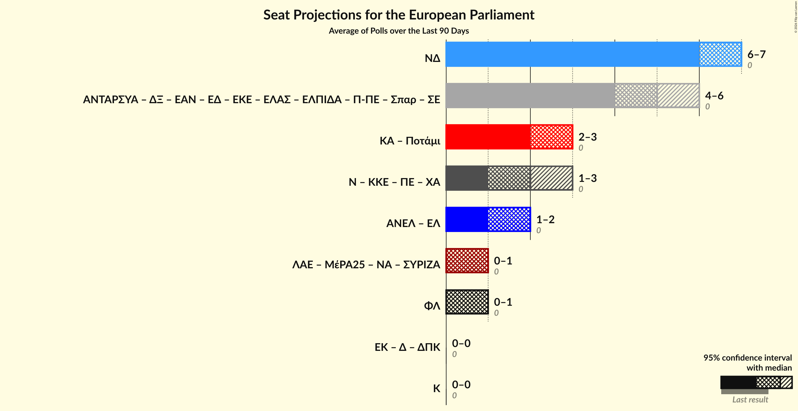

# Overview

The table below lists the most recent polls (less than 90 days old) registered and analyzed so far.

| Period     | Polling firm/Commissioner(s) | ΣΥΡΙΖΑ | ΛΑΕ | ΜέΡΑ25 | ΝΑ | Κ | Ποτάμι | ΚΑ | Δ | ΕΚ | ΔΠΚ | ΝΔ | ΑΝΕΛ | ΕΛ | ΦΛ | ΧΑ | ΚΚΕ | Ν | ΠΕ | ΑΝΤΑΡΣΥΑ | ΔΞ | ΕΑΝ | ΕΔ | ΕΚΕ | ΕΛΑΣ | ΕΛΠΊΔΑ | Π-ΠΕ | Σπαρ | ΣΕ |
|:----------:|:----------------------------:|:--:|:--:|:--:|:--:|:--:|:--:|:--:|:--:|:--:|:--:|:--:|:--:|:--:|:--:|:--:|:--:|:--:|:--:|:--:|:--:|:--:|:--:|:--:|:--:|:--:|:--:|:--:|:--:|
| 9 June 2024 | General Election | 0.0%   0 | 0.0%   0 | 0.0%   0 | 0.0%   0 | 0.0%   0 | 0.0%   0 | 0.0%   0 | 0.0%   0 | 0.0%   0 | 0.0%   0 | 0.0%   0 | 0.0%   0 | 0.0%   0 | 0.0%   0 | 0.0%   0 | 0.0%   0 | 0.0%   0 | 0.0%   0 | 0.0%   0 | 0.0%   0 | 0.0%   0 | 0.0%   0 | 0.0%   0 | 0.0%   0 | 0.0%   0 | 0.0%   0 | 0.0%   0 | 0.0%   0 |
| N/A | [Poll Average](average.html) | 1–3%   0–1 | N/A   N/A | 2–4%   0–1 | 0–2%   0 | N/A   N/A | N/A   N/A | 10–15%   2–3 | N/A   N/A | N/A   N/A | 0–2%   0 | 26–33%   6–7 | N/A   N/A | 5–10%   1–2 | 2–6%   0–1 | N/A   N/A | 5–10%   1–2 | 0–3%   0 | 3–7%   0–2 | N/A   N/A | N/A   N/A | N/A   N/A | N/A   N/A | N/A   N/A | 14–19%   3–4 | 2–8%   0–2 | N/A   N/A | 1–2%   0 | 2–6%   0–1 |
| [17–20 October 2026](2026-10-20-PulseRC.html) | Pulse RC   ΣΚΑΪ TV | 2–3%   0–1 | N/A   N/A | 2–4%   0–1 | N/A   N/A | N/A   N/A | N/A   N/A | 11–15%   2–3 | N/A   N/A | N/A   N/A | N/A   N/A | 27–33%   6–7 | N/A   N/A | 6–9%   1–2 | 2–5%   0–1 | N/A   N/A | 5–9%   1–2 | N/A   N/A | 4–7%   1–2 | N/A   N/A | N/A   N/A | N/A   N/A | N/A   N/A | N/A   N/A | 14–19%   3–4 | 3–5%   0–1 | N/A   N/A | N/A   N/A | 3–5%   0–1 |
| [14–20 October 2026](2026-10-20-MetronAnalysis.html) | Metron Analysis   Mega | 1–3%   0 | N/A   N/A | 2–4%   0–1 | N/A   N/A | N/A   N/A | N/A   N/A | 11–15%   2–3 | N/A   N/A | N/A   N/A | N/A   N/A | 27–33%   6–7 | N/A   N/A | 5–8%   1–2 | 4–7%   1–2 | N/A   N/A | 4–7%   1–2 | 1–3%   0 | 4–7%   1–2 | N/A   N/A | N/A   N/A | N/A   N/A | N/A   N/A | N/A   N/A | 13–17%   3–4 | 3–5%   0–1 | N/A   N/A | N/A   N/A | 3–5%   0–1 |
| [16–19 October 2026](2026-10-19-GPO.html) | GPO   iefimerida.gr | 1–3%   0–1 | N/A   N/A | 1–3%   0–1 | N/A   N/A | N/A   N/A | N/A   N/A | 11–15%   2–3 | N/A   N/A | N/A   N/A | N/A   N/A | 26–33%   6–7 | N/A   N/A | 7–11%   1–2 | 3–5%   0–1 | N/A   N/A | 8–12%   2–3 | 1–3%   0 | 3–6%   1–2 | N/A   N/A | N/A   N/A | N/A   N/A | N/A   N/A | N/A   N/A | 13–18%   3–4 | 2–4%   0–1 | N/A   N/A | N/A   N/A | 2–4%   0–1 |
| [12–14 October 2026](2026-10-14-Marc.html) | Marc   ANT1 | 1–3%   0 | N/A   N/A | 2–4%   0–1 | N/A   N/A | N/A   N/A | N/A   N/A | 11–14%   2–3 | N/A   N/A | N/A   N/A | N/A   N/A | 28–33%   6–7 | N/A   N/A | 6–9%   1–2 | 3–5%   0–1 | N/A   N/A | 6–9%   1–2 | 1–3%   0 | 4–7%   1–2 | N/A   N/A | N/A   N/A | N/A   N/A | N/A   N/A | N/A   N/A | 14–18%   3–4 | 3–6%   1 | N/A   N/A | N/A   N/A | 3–6%   1 |
| [8–13 October 2026](2026-10-13-Alco.html) | Alco   flash.gr | 1–4%   0–1 | N/A   N/A | 2–4%   0–1 | N/A   N/A | N/A   N/A | N/A   N/A | 11–16%   2–4 | N/A   N/A | N/A   N/A | 0–2%   0 | 25–31%   5–7 | N/A   N/A | 5–9%   1–2 | 1–3%   0 | N/A   N/A | 7–11%   1–2 | 1–3%   0–1 | 3–6%   1 | N/A   N/A | N/A   N/A | N/A   N/A | N/A   N/A | N/A   N/A | 14–19%   3–4 | 2–5%   0–1 | N/A   N/A | N/A   N/A | 4–6%   1–2 |
| [7–12 October 2026](2026-10-12-OpinionPoll.html) | Opinion Poll   Action 24 | 1–3%   0 | N/A   N/A | 2–4%   0–1 | N/A   N/A | N/A   N/A | N/A   N/A | 10–15%   2–3 | N/A   N/A | N/A   N/A | N/A   N/A | 27–33%   6–7 | N/A   N/A | 5–9%   1–2 | 2–5%   0–1 | N/A   N/A | 6–9%   1–2 | 1–2%   0 | 4–7%   1 | N/A   N/A | N/A   N/A | N/A   N/A | N/A   N/A | N/A   N/A | 14–18%   3–4 | 3–6%   1 | N/A   N/A | N/A   N/A | 2–5%   0–1 |
| [6–10 October 2026](2026-10-10-Interview.html) | Interview   Political.gr | 2–3%   0 | N/A   N/A | 3–4%   0–1 | 0–1%   0 | N/A   N/A | N/A   N/A | 13–16%   3 | N/A   N/A | N/A   N/A | 2–3%   0 | 28–31%   6–7 | N/A   N/A | 7–9%   1–2 | 3–4%   1 | N/A   N/A | 5–7%   1–2 | 0–1%   0 | 2–4%   0–1 | N/A   N/A | N/A   N/A | N/A   N/A | N/A   N/A | N/A   N/A | 14–17%   3–4 | 4–5%   1 | N/A   N/A | N/A   N/A | 3–4%   1 |
| [18–21 September 2026](2026-09-21-RealPolls.html) | Real Polls   Protagon | 1–2%   0 | N/A   N/A | 2–4%   0–1 | 1–2%   0 | N/A   N/A | N/A   N/A | 10–13%   2–3 | N/A   N/A | N/A   N/A | 0–2%   0 | 26–31%   6–7 | N/A   N/A | 5–7%   1–2 | 3–6%   1 | N/A   N/A | 5–7%   1 | 1–2%   0 | 4–6%   1–2 | N/A   N/A | N/A   N/A | N/A   N/A | N/A   N/A | N/A   N/A | 16–20%   4 | 6–9%   1–2 | N/A   N/A | 1–2%   0 | N/A   N/A |
| 9 June 2024 | General Election | 0.0%   0 | 0.0%   0 | 0.0%   0 | 0.0%   0 | 0.0%   0 | 0.0%   0 | 0.0%   0 | 0.0%   0 | 0.0%   0 | 0.0%   0 | 0.0%   0 | 0.0%   0 | 0.0%   0 | 0.0%   0 | 0.0%   0 | 0.0%   0 | 0.0%   0 | 0.0%   0 | 0.0%   0 | 0.0%   0 | 0.0%   0 | 0.0%   0 | 0.0%   0 | 0.0%   0 | 0.0%   0 | 0.0%   0 | 0.0%   0 | 0.0%   0 |

Only polls for which at least the sample size has been published are included in the table above.

**Legend:**
+ **Top half of each row:** Voting intentions (95% confidence interval)
+ **Bottom half of each row:** Seat projections for the European Parliament (95% confidence interval)
+ **ΣΥΡΙΖΑ:** Συνασπισμός Ριζοσπαστικής Αριστεράς (GUE/NGL)
+ **ΛΑΕ:** Λαϊκή Ενότητα (GUE/NGL)
+ **ΜέΡΑ25:** Μέτωπο Ευρωπαϊκής Ρεαλιστικής Ανυπακοής (GUE/NGL)
+ **ΝΑ:** Νέα Αριστερά (GUE/NGL)
+ **Κ:** Κόσμος (Greens/EFA)
+ **Ποτάμι:** Το Ποτάμι (S&D)
+ **ΚΑ:** Κίνημα Αλλαγής (S&D)
+ **Δ:** Δημοκράτες (RE)
+ **ΕΚ:** Ένωση Κεντρώων (RE)
+ **ΔΠΚ:** Δημοκράτες–Προοδευτικό Κέντρο (RE)
+ **ΝΔ:** Νέα Δημοκρατία (EPP)
+ **ΑΝΕΛ:** Ανεξάρτητοι Έλληνες (ECR)
+ **ΕΛ:** Ελληνική Λύση (ECR)
+ **ΦΛ:** Φωνή Λογικής (PfE)
+ **ΧΑ:** Χρυσή Αυγή (NI)
+ **ΚΚΕ:** Κομμουνιστικό Κόμμα Ελλάδας (NI)
+ **Ν:** Δημοκρατικό Πατριωτικό Κίνημα ΝΙΚΗ (NI)
+ **ΠΕ:** Πλεύση Ελευθερίας (NI)
+ **ΑΝΤΑΡΣΥΑ:** Αντικαπιταλιστική Αριστερή Συνεργασία για την Ανατροπή (*)
+ **ΔΞ:** Δημιουργία, Ξανά (*)
+ **ΕΑΝ:** ΕΑΝ… (*)
+ **ΕΔ:** Εθνική Δημιουργία (*)
+ **ΕΚΕ:** Εθνικό Κόμμα – Έλληνες (*)
+ **ΕΛΑΣ:** Ελληνική Αριστερή Συμπαράταξη (*)
+ **ΕΛΠΊΔΑ:** Ελπίδα για την Δημοκρατία (*)
+ **Π-ΠΕ:** Πατριώτες (*)
+ **Σπαρ:** Σπαρτιάτες (*)
+ **ΣΕ:** Συμμαχία Ελλήνων (*)
+ **N/A (single party):** Party not included the published results
+ **N/A (entire row):** Calculation for this opinion poll not started yet

